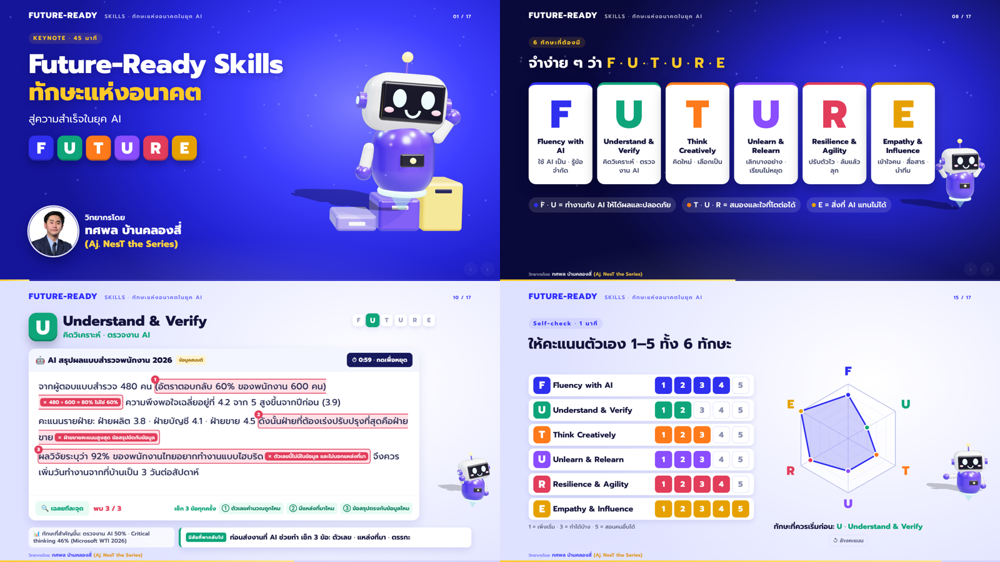

# Future-Ready Skills: ทักษะแห่งอนาคต สู่ความสำเร็จในยุค AI

Keynote 45 นาที โดย ทศพล บ้านคลองสี่ (Aj. NesT the Series)
หัวหน้าภาควิชาวิศวกรรมมัลติมีเดียและเอ็นเตอร์เทนเมนต์ คณะวิศวกรรมศาสตร์ มหาวิทยาลัยกรุงเทพ



## เปิดใช้งาน

เปิด `index.html` ด้วย Chrome (ไฟล์เดียว ใช้งานออฟไลน์ได้)

| ปุ่ม | การทำงาน |
| --- | --- |
| → / Space / คลิกพื้นที่ว่าง | หน้าถัดไป |
| ← / คลิกขวา | ย้อนกลับ |
| F | เต็มจอ |
| P | Speaker Notes หน้าต่างแยก |
| N | Notes ในจอ |

## โครงเนื้อหา F.U.T.U.R.E (17 หน้า)

| ตัว | ทักษะ |
| --- | --- |
| F | Fluency with AI · ใช้ AI เป็น · รู้ข้อจำกัด |
| U | Understand & Verify · คิดวิเคราะห์ · ตรวจงาน AI |
| T | Think Creatively · คิดใหม่ · เลือกเป็น |
| U | Unlearn & Relearn · เลิกบางอย่าง · เรียนไม่หยุด |
| R | Resilience & Agility · ปรับตัวไว · ล้มแล้วลุก |
| E | Empathy & Influence · เข้าใจคน · สื่อสาร · นำทีม |

## แหล่งข้อมูล

- [WEF Future of Jobs Report 2025](https://www.weforum.org/publications/the-future-of-jobs-report-2025/in-full/3-skills-outlook/)
- [Microsoft Work Trend Index 2026](https://microsoft.com/en-us/worklab/work-trend-index/agents-human-agency-and-the-opportunity-for-every-organization)
- [LinkedIn Skills on the Rise 2026](https://news.linkedin.com/2026/Skills-on-the-rise-2026)

ตัวอย่างเคสในสไลด์ทั้งหมดเป็นข้อมูลสมมติ

## แก้ไขและ Build ใหม่

```bash
cd source
npm install esbuild three @fontsource/prompt
python3 gen.py      # สร้าง src/slides.html + notes.json
node build.mjs      # ได้ out.html (คัดลอกไปเป็น index.html)
```
